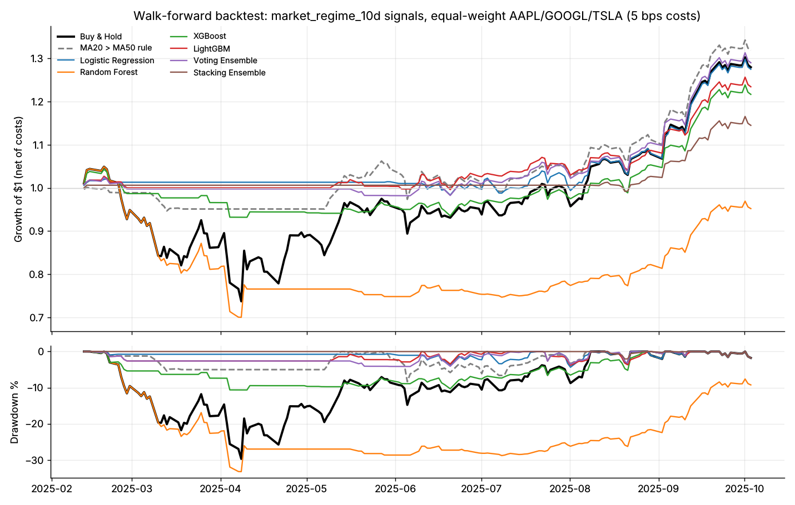

# Walk-Forward Backtest — `market_regime_10d`

Generated 2026-11-01 13:50 by `09_backtesting_trading/walk_forward_backtest.py`.

- Prices: AAPL, GOOGL, TSLA daily closes, equal-weighted portfolio
- Window: 2025-02-12 to 2025-10-03 (162 trading days, all signals out-of-sample)
- Signal: long/flat when P(market_regime_10d) > 0.5; executed 1 close(s) after the signal
- Costs: 5.0 bps per unit turnover, one way
- Features: PCA(35) fit per fold

| Strategy | Total return | Ann. return | Ann. vol | Sharpe | Max DD | Calmar | Exposure | Trades | Trade win rate | Daily win rate | Shift-test p | Placebo p |
| --- | ---: | ---: | ---: | ---: | ---: | ---: | ---: | ---: | ---: | ---: | ---: | ---: |
| Buy & Hold | 27.9% | 46.7% | 39.7% | 1.16 | -29.7% | 1.57 | 100.0% | 3 | 100.0% | 52.7% | — | — |
| MA20 > MA50 rule | 31.8% | 53.7% | 18.3% | 2.44 | -8.3% | 6.44 | 52.7% | 7 | 57.1% | 53.9% | 0.056 | — |
| Logistic Regression | 27.5% | 45.9% | 15.6% | 2.50 | -4.4% | 10.54 | 45.3% | 17 | 52.9% | 56.4% | 0.048 | 0.200 |
| Random Forest | -4.8% | -7.3% | 27.9% | -0.13 | -33.2% | -0.22 | 52.1% | 38 | 52.6% | 48.6% | 0.944 | 1.000 |
| XGBoost | 21.7% | 35.7% | 15.6% | 2.04 | -10.6% | 3.35 | 44.0% | 41 | 53.7% | 52.8% | 0.105 | 0.350 |
| LightGBM | 23.4% | 38.7% | 12.9% | 2.59 | -3.8% | 10.10 | 38.5% | 37 | 54.1% | 55.6% | 0.048 | 0.150 |
| Voting Ensemble | 29.0% | 48.6% | 14.2% | 2.87 | -4.1% | 11.73 | 42.0% | 29 | 58.6% | 55.4% | 0.024 | 0.150 |
| Stacking Ensemble | 14.5% | 23.4% | 8.1% | 2.64 | -2.1% | 11.28 | 16.5% | 12 | 75.0% | 56.2% | 0.016 | 0.100 |

## Reading this table

- **Placebo p** (the test to trust; only with `--placebo-runs N`): each model is
  retrained N times on randomly permuted labels and traded identically. p is the
  share of those no-information strategies whose net Sharpe matches or beats the
  real one. A model with genuine skill should beat nearly all of them.
- **Shift-test p**: share of circularly shifted copies of the strategy (same
  exposure, trades and holding periods, timing randomised) whose net Sharpe is at
  least as high. It is **optimistic**: feature-driven positions that happen to
  sit out one large sell-off pass it easily. In placebo checks on this data,
  models trained on shuffled labels scored p < 0.05 about 20% of the time.
- Compare every model with **Buy & Hold** and the rule-based **MA20 > MA50**
  strategy. A model that only matches them adds nothing.
- Picking the best of several models on one window is optimistic; three
  correlated tech stocks over under a year is a very small sample.

## Walk-forward folds

| Fold | Train period | Test period | Train rows | Test rows |
| ---: | --- | --- | ---: | ---: |
| 1 | 2024-10-04 → 2024-11-21 | 2024-12-09 → 2025-02-07 | 0 | 123 |
| 2 | 2024-10-04 → 2025-01-24 | 2025-02-10 → 2025-04-08 | 81 | 123 |
| 3 | 2024-10-04 → 2025-03-25 | 2025-04-09 → 2025-06-06 | 204 | 123 |
| 4 | 2024-10-04 → 2025-05-22 | 2025-06-09 → 2025-08-06 | 327 | 123 |
| 5 | 2024-10-04 → 2025-07-23 | 2025-08-07 → 2025-10-03 | 450 | 123 |
