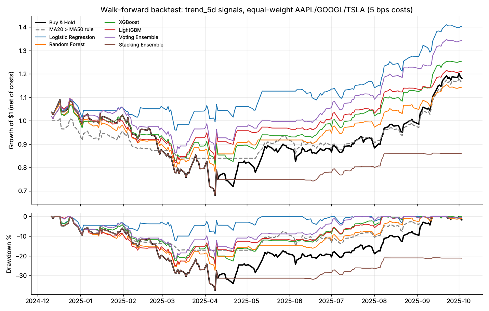

# Walk-Forward Backtest — `trend_5d`

Generated 2026-11-01 12:30 by `09_backtesting_trading/walk_forward_backtest.py`.

- Prices: AAPL, GOOGL, TSLA daily closes, equal-weighted portfolio
- Window: 2024-12-11 to 2025-10-03 (203 trading days, all signals out-of-sample)
- Signal: long/flat when P(trend_5d) > 0.5; executed 1 close(s) after the signal
- Costs: 5.0 bps per unit turnover, one way
- Features: PCA(35) fit per fold

| Strategy | Total return | Ann. return | Ann. vol | Sharpe | Max DD | Calmar | Exposure | Trades | Trade win rate | Daily win rate | Luck-test p |
| --- | ---: | ---: | ---: | ---: | ---: | ---: | ---: | ---: | ---: | ---: | ---: |
| Buy & Hold | 18.1% | 22.9% | 38.6% | 0.72 | -37.5% | 0.61 | 100.0% | 3 | 100.0% | 51.6% | — |
| MA20 > MA50 rule | 16.3% | 20.7% | 21.2% | 0.99 | -17.5% | 1.18 | 58.5% | 9 | 44.4% | 51.4% | 0.188 |
| Logistic Regression | 40.3% | 52.2% | 22.8% | 1.96 | -12.1% | 4.31 | 41.9% | 69 | 59.4% | 55.3% | 0.024 |
| Random Forest | 14.3% | 18.1% | 29.9% | 0.70 | -27.5% | 0.66 | 56.0% | 73 | 56.2% | 51.3% | 0.394 |
| XGBoost | 25.4% | 32.5% | 26.6% | 1.19 | -23.9% | 1.36 | 50.9% | 98 | 54.1% | 54.5% | 0.109 |
| LightGBM | 21.1% | 26.8% | 28.8% | 0.97 | -25.0% | 1.07 | 48.1% | 83 | 50.6% | 52.6% | 0.242 |
| Voting Ensemble | 34.2% | 44.1% | 25.2% | 1.58 | -21.2% | 2.08 | 47.5% | 82 | 52.4% | 55.0% | 0.048 |
| Stacking Ensemble | -14.1% | -17.2% | 32.6% | -0.42 | -37.5% | -0.46 | 49.6% | 29 | 55.2% | 48.0% | 0.976 |

## Reading this table

- **Luck-test p**: share of circularly shifted copies of the strategy (same
  exposure, trades and holding periods, but timing randomised) whose net Sharpe
  is at least as high. Values near 0 suggest real timing skill; values near or
  above 0.5 mean the timing is no better than chance.
- Compare every model with **Buy & Hold** and the rule-based **MA20 > MA50**
  strategy. A model that only matches them adds nothing.
- Picking the best of several models on one window is optimistic; three
  correlated tech stocks over under a year is a very small sample.

## Walk-forward folds

| Fold | Train period | Test period | Train rows | Test rows |
| ---: | --- | --- | ---: | ---: |
| 1 | 2024-10-04 → 2024-11-29 | 2024-12-09 → 2025-02-07 | 120 | 123 |
| 2 | 2024-10-04 → 2025-01-31 | 2025-02-10 → 2025-04-08 | 243 | 123 |
| 3 | 2024-10-04 → 2025-04-01 | 2025-04-09 → 2025-06-06 | 366 | 123 |
| 4 | 2024-10-04 → 2025-05-30 | 2025-06-09 → 2025-08-06 | 489 | 123 |
| 5 | 2024-10-04 → 2025-07-30 | 2025-08-07 → 2025-10-03 | 612 | 123 |
